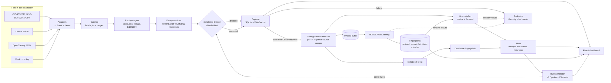

# Honeypot Behaviour Fingerprinting & Adaptive Firewall

A self-contained prototype that **replays real honeypot logs and labelled flow datasets**, learns
behavioural **fingerprints** without labels, recognises the same behaviour when it **returns from new
IPs**, and generates **nftables / iptables / Suricata** rules. A dark SOC-style dashboard shows it all live.

- **No traffic is generated or sent.** Input comes only from adapters that read files: CICFlowMeter
  CSVs, Cowrie JSON, OpenCanary JSON and Zeek `conn.log`.
- **Firewall rules are text only.** Nothing runs `nft`, `iptables` or `ufw`. "Active" rules drive a
  *simulated* firewall inside the app, which drops matching replayed events so you can see the effect.
- Ground-truth labels from the datasets are used **only** by the evaluation module. The detection
  pipeline receives a label-free event type (`ObservedEvent`).

## Quick start

```bash
docker compose up --build        # dashboard: http://localhost:5173   API docs: http://localhost:5173/docs
```

Without Docker (Python 3.11 + Node 20+):

```bash
make install && make dev         # or: ./scripts/dev.sh   |   Windows: .\scripts\dev.ps1
make test                        # backend pytest + frontend vitest + build smoke test
make demo                        # headless deterministic demo, prints the story and metrics
```

Datasets are read from `../data` next to this folder (`E:\IDS\data` here), or from `HFP_DATA_DIR`.
They are mounted read-only into the container and are never committed (see `.gitignore`). With no
datasets present, the app falls back to the small fixtures in `backend/tests/fixtures`.

## Getting the data

| Source | Where to get it | Which files |
|---|---|---|
| **CIC-IDS2017** | https://www.unb.ca/cic/datasets/ids-2017.html | `GeneratedLabelledFlows.zip` → `TrafficLabelling/*.csv`. These include Source IP and Timestamp. The `MachineLearningCVE` variant lacks them and is rejected with a clear error. `Tuesday-WorkingHours.pcap_ISCX.csv` (FTP/SSH-Patator) is the best demo file. |
| **CIC-DDoS2019** | https://www.unb.ca/cic/datasets/ddos-2019.html | `CSV-01-12.zip` / `CSV-03-11.zip` (e.g. `Syn.csv`, `DrDoS_DNS.csv`). The files are large: indexing takes minutes once, then it is cached. Loads are capped by `max_rows`. |
| **Zeek conn.log** | your Zeek sensor, or IoT-23 (https://www.stratosphereips.org/datasets-iot23) | `conn.log` (TSV or JSON). IoT-23 `conn.log.labeled` files are read with their `label` / `detailed-label` columns as ground truth. |
| **Cowrie** | your Cowrie honeypot (https://github.com/cowrie/cowrie) | `var/log/cowrie/cowrie.json*` |
| **OpenCanary** | your OpenCanary node (https://github.com/thinkst/opencanary) | the JSON log (default `/var/tmp/opencanary.log`) |

Drop files anywhere under the data folder and press **Rescan** on the Replay Control page. Cowrie,
OpenCanary and unlabelled Zeek logs carry no ground truth. You can attach a behaviour label to a
slice with **label override** when you replay it.

## Architecture



```
backend/app/
  adapters/      cicflow.py, cowrie.py, opencanary.py, zeek.py, catalog.py (discovery + index cache)
  labels.py      behaviour vocabulary + the single dataset-label → behaviour table
  replay/        engine.py (clock, slices, IP remap, looping), plans.py (custom, returning, demo)
  honeypot/      decoy services (fill login outcomes / HTTP codes, optional fake login after N tries)
  features/      sliding-window feature extraction (49 numeric features + token families)
  fingerprint/   scaler, MinHash, similarity, categoriser (rule layer), HDBSCAN builder, store
  detection/     Isolation Forest, live matcher, episodes / returning detection
  rules/         templates (3 formats), generator (lifecycle, allowlist), simulated firewall
  alerts/        dedupe + escalation
  evaluation/    precision/recall/F1, confusion, time-to-detect/rule, returning recognition
  pipeline.py    orchestrator (synchronous, deterministic)   runtime.py  replay thread + WS hub
  api/           REST routes      main.py  FastAPI app (/api, /ws, /docs)   demo.py  headless demo
frontend/src/    pages (Replay, Overview, Fingerprints, Alerts, Rules, Evaluation, Settings), lib, components
```

## Running the demo

**Dashboard:** open *Replay Control* and press **Run demo (1×)**. It takes about 3 minutes; **Run at 10×**
is faster. **Headless:** `make demo` (or `python -m app.demo` in `backend/`).

The demo is a fixed, scripted replay order built from dataset slices (fixed split, seed and IP remap,
so it is deterministic). It prefers CIC-IDS2017 `SSH-Patator` and falls back to other attack classes
or to the fixtures:

1. **T+0:** the benign background from the same dataset calibrates the scaler and Isolation Forest.
2. **T+30 s:** *part A* of the attack class (the first 45 % of its records, original IPs, time
   compressed to ~50 s). HDBSCAN forms a fingerprint, and a rule is **suggested**.
3. The operator switches the firewall to **auto-apply** (simulated).
4. *Part B* (the remaining records) **returns from consistently remapped IPs**, timestamps shifted
   to now. It matches the part-A fingerprint, which raises a **Returning behaviour** alert. The rule
   is auto-applied and the dropped traffic is visible on the Live Overview chart.

## Replay engine

- **Custom mix:** any number of slices, each with a source, labels, a dataset time range, an offset
  on the replay timeline, `compress` (dataset seconds per replay second), `max_rows` (a contiguous
  slice), `sample_every`, IP remap, label override, and `repeat` (loop a short slice). Slices merge
  in timestamp order.
- **Speed:** 1×, 10× or 100×, with pause/resume/stop. The clock advances in fixed 0.25 s steps, so
  a plan always produces the same results whatever the wall-clock speed. If the CPU falls behind,
  the *effective speed* shown in the header drops instead of the clock skipping events.
- **Returning-attacker mode:** splits one attack class in time. Part A builds fingerprints (it can
  fast-forward) and part B replays with consistent IP remapping and timestamps shifted to now.
- **Looping:** very short slices, such as the 20–50-record fixtures, are repeated back-to-back so the
  window-level pipeline has enough volume. Benign background loops with fresh IPs per copy. Plans
  say when looping happened.

## How the algorithms work

**Flow-level features.** Every `hop` (5 s), events from the last `window` (10 s) are grouped:
- by **source IP**, when the IP has ≥ `min_events_per_ip` events or a long-horizon history;
- otherwise into **campaign-cluster groups** of sparse sources that share a traffic shape
  (protocol/service/port/flag-shape or request class). This is how spoofed or distributed attacks
  become visible.

49 numeric features cover:
- volume (flows, packets, bytes, connections per second);
- protocol mix and flag ratios (SYN, half-open, SYN/ACK, RST);
- flow shape (duration, packets and bytes per flow, reply ratio) and packet-size statistics;
- inter-arrival timing (mean, std, CV, burstiness) and breadth (destination ports and hosts, paths,
  users, passwords);
- authentication outcomes, HTTP error/UA/path entropy and sensitive paths, and command counts;
- service mix, long-horizon history (300 s) and source count / per-source rate.

Flow totals stand in when per-packet fields are missing. **Anything a source cannot observe is NaN,
not 0.** It becomes "no evidence" after scaling and is skipped by the categoriser. Categorical traits
go into separate token families (`svc`, `port`, `flags`, `size`, `path`, `ua`, `user`, `pw`,
`cmd` with command bigrams, `payload`).

**Scaling.** A `StandardScaler` fitted on the recent window buffer provides the spread, floored at
0.2. It is centred on the benign baseline, so normal traffic sits near the origin. It is persisted
with joblib.

**Clustering: HDBSCAN, not DBSCAN.** Densities differ wildly: a flood produces hundreds of
near-identical windows, a scan only a handful. DBSCAN's single `eps` would either merge the sparse
groups or shatter the dense ones. HDBSCAN keeps the most stable clusters across densities, needs no
`k`, and leaves outliers as noise (and so as candidates) instead of forcing them into a cluster.
Before each run:
- unassigned windows are re-matched against the existing fingerprints, so stragglers don't seed
  mixed clusters;
- fingerprints whose centroids have drifted are re-categorised.

**Fingerprints** hold:
- a raw centroid and spread;
- token counts and a 128-permutation **MinHash** (SplitMix64, numpy);
- feature importance (z vs baseline);
- IPs, ASNs and countries, an episodes list, a version history, and a hit timeline.

Each live match nudges the centroid slightly (EMA), so fingerprints keep learning.

**Categoriser (explainable rule layer).** Each behaviour has one or more condition lists over
centroid features. The first condition, and any marked `*`, is *defining* and must hold. Confidence is
the share of observable conditions met. Below 0.75 the fingerprint is labelled *benign* if it sits
close to the baseline (mean |z| < 1) and *unknown anomaly* otherwise. The reasons are shown in the UI.

**Similarity:** `score = (w1·cos + w2·J) / (w1 + w2)` (defaults 0.6 / 0.4, threshold 0.85, all
editable in Settings).
- `cos` is the cosine in scaled space with an extra constant *anchor* dimension. Low-energy,
  benign-like windows then point along the anchor instead of in random directions, and replays at a
  different rate (same direction) still score high.
- `J` for live windows is **Jaccard containment** |W ∩ F| / |W| per token family, averaged over the
  families the window has. A 10-second window holds only a small sample of a fingerprint's traits,
  so plain Jaccard would penalise it for being small.
- Fingerprint-to-fingerprint comparisons (compare, merge) use the MinHash Jaccard estimate.

Every match carries a breakdown: per-feature cosine contributions, divergent features, per-family
containment, and known versus new tokens.

**Detection.**
- **Isolation Forest:** trained on the baseline windows. Unmatched windows that it flags become (or
  join) **candidate fingerprints**. You can promote, merge or dismiss candidates; clustering also
  auto-promotes a candidate once a dense cluster confirms it.
- **Episodes:** activity of one fingerprint separated by more than `episode_gap_seconds`. A new
  episode whose source IPs are disjoint from every earlier episode raises a **Returning behaviour**
  alert.
- **Alerts:** de-duplicated per (type, fingerprint, episode). Severity escalates at 10 and 50 hits.

**Rules.** One rule per fingerprint episode. Its kind depends on the category:

| Category | Rule |
|---|---|
| SYN flood | SYN rate limit (meter / hashlimit) |
| UDP and ICMP floods | rate limits |
| HTTP flood | IP-set block |
| Slowloris | connection limit |
| Scans, brute force | IP blocks with timeout (Suricata `threshold` for brute force) |
| Web probing, post-login shell, malware download | Suricata `content` signatures plus IP block |

Lifecycle: `suggested → approved → active → expired / rejected`. Each rule records its fingerprint,
reason, creation time, expiry and history. In **suggest mode** a user approves rules; in **auto mode**
they activate immediately, except unknown-anomaly rules, which are never auto-applied. The
**allowlist** strips IPs from every rule and is checked first by the simulated firewall, including
rate limits. Active rules export per format from the Firewall Rules page.

**Evaluation** joins window results (event `seq` numbers) with the labels of the events they contain:
- window-level confusion matrices: online, and "after clustering";
- per-behaviour P/R/F1 and attack-vs-benign P/R/F1;
- mean time to detect and time to rule per ground-truth campaign;
- returning-attacker recognition: did part-B windows match a fingerprint that part-A windows built
  or matched, and was a returning alert raised?

## Label mapping

Every dataset label maps to a behaviour in **one table**, `backend/app/labels.py::LABEL_MAP`. Raw
labels are stored verbatim in `ground_truth_label`.

| Dataset labels | Behaviour |
|---|---|
| CIC-IDS2017 `DoS Hulk`, `DoS GoldenEye`, `DDoS` | HTTP flood |
| `DoS slowloris`, `DoS Slowhttptest` | Slowloris |
| `PortScan` | Fast port scan |
| `SSH-Patator`, `FTP-Patator` | SSH / FTP brute force |
| `Web Attack – Brute Force` | Web login brute force |
| `Web Attack – XSS`, `Sql Injection` | Web vuln probing |
| `Bot` | C2 |
| `Infiltration`, `Heartbleed` | Infiltration |
| CIC-DDoS2019 `Syn` | SYN flood |
| `DrDoS_*`, `UDP`, `UDP-lag`, `TFTP`, … | UDP flood / amplification |
| `WebDDoS` | HTTP flood |
| IoT-23 `PartOfAHorizontalPortScan` | Port scan |
| `C&C*`, `Okiru` | C2 |
| `FileDownload` | Malware download |

**Behaviours with no data source**, shown as such in the UI rather than faked:
- search-engine crawler, aggressive scraper, ICMP flood;
- stealthy port scan (there is no labelled slow-scan class);
- credential stuffing and post-login shell. These exist in Cowrie/OpenCanary logs but carry no
  labels; use a label override.

## Adding a new input adapter

1. Create `backend/app/adapters/<name>.py` with a subclass of `Adapter`:
   - `name`, `description`, `extensions`;
   - `sniff(path, head)`, which recognises the format from the first 8 KB;
   - `iter_events(path, **filters)`, which yields `Event`s. Fill what the source has, leave
     everything else `None`, put any dataset label in `ground_truth_label`, set `event_type`, and
     set `auth_attempt` / `auth_success` for logins.
2. Register it in `adapters/__init__.py` (`ADAPTERS` and the sniff order in `detect_adapter`).
3. If the source has labels, add them to `LABEL_MAP` in `labels.py`.
4. Add a 20–50-record fixture in the source's real format to `backend/tests/fixtures/` and a test in
   `tests/test_adapters.py`.

The catalog, replay engine, features and dashboard pick it up without further changes.

## API

OpenAPI docs live at `/docs`. Main routes:

| Area | Routes |
|---|---|
| Sources | `GET /api/sources`, `POST /api/sources/refresh`, `GET /api/behaviours` |
| Replay | `POST /api/replay/{custom,returning,demo}`, `POST /api/replay/{pause,resume,stop,speed}`, `GET /api/replay/{status,campaigns}`, `POST /api/reset` |
| Events | `GET /api/events` (paginated, filterable) |
| Fingerprints | `GET /api/fingerprints[/{id}]`, `GET /api/fingerprints/{projection,compare,meta}`, `PATCH`/`DELETE /api/fingerprints/{id}`, `POST /api/fingerprints/{id}/{promote,dismiss,split}`, `POST /api/fingerprints/merge` |
| Alerts | `GET /api/alerts`, `POST /api/alerts/{id}/{ack,resolve,reopen}` |
| Rules | `GET /api/rules`, `POST /api/rules/{id}/{approve,reject,expire}`, `PATCH /api/rules/{id}`, `GET /api/rules/export?format=nftables\|iptables\|suricata` |
| Allowlist, settings | `GET/POST/DELETE /api/allowlist`, `GET/PUT /api/settings` |
| Metrics | `GET /api/metrics/{overview,evaluation}` |
| Live stream | WebSocket `/ws`: batched "tick" messages about 4 times a second (KPIs, series, ≤150 recent events, changed alerts/fingerprints/rules, narration) |

The dashboard's live event table is virtualised, and state updates once per tick. The pipeline
processed about 18k events in the first second of a 100× replay on a laptop (Windows, Python 3.11).

## Tests

```bash
cd backend && .venv/Scripts/python -m pytest -q      # or .venv/bin/python
cd frontend && npm test && npm run smoke
```

Backend coverage:
- each adapter against its fixture (fields, labels, the CIC-IDS2017 12-hour timestamps, NaN and
  Infinity, IoT-23 spacing, Cowrie session ports, OpenCanary flags);
- the label table and no-data-source markers;
- replay ordering, step-size independence, compression, remap, splits and looping;
- feature correctness on hand-built events, including NaN for unobservable fields and grouping of
  sparse sources;
- clustering separating benign, SSH brute force, SYN flood, UDP flood and C2 on a seeded mixed
  replay;
- part B matching the part-A fingerprint above threshold with a returning alert and an auto-applied
  rule;
- rule rendering for every category and format;
- the allowlist never being targeted or dropped;
- demo determinism;
- an end-to-end API test, including the WebSocket.

## Paper and experiments

`paper/main.tex` is an IEEE-format paper describing this system (IEEEtran, compiles with
pdfLaTeX/XeLaTeX or Tectonic; figures use TikZ/pgfplots). Every number in it comes from
`backend/experiments/paper_experiments.py`, which writes `paper/results/results.json` and the
demo timeline CSV:

```bash
cd backend && python -m experiments.paper_experiments    # ~5 minutes on a laptop
```

The published numbers were produced on the bundled fixtures. After adding the real datasets to
the data folder, regenerate them and update the tables before quoting any result.

## Limitations and next steps

- The bundled fixtures are tiny and **looped**, so fixture-only runs show artefacts (repeated
  source ports, perfectly periodic timing). Use the real datasets for meaningful metrics.
- The CIC datasets reuse one attacker IP for several classes, so per-IP windows can mix behaviours
  when slices overlap in time. Those windows are honestly reported as *unknown anomaly*.
- CIC-IDS2017 timestamps have minute resolution. Rows sharing a minute are spread evenly across it
  (file order), which approximates real inter-arrival times.
- The categoriser is a hand-written rule layer. Next step: learn category thresholds from labelled
  data, or train a classifier on fingerprint centroids, keeping the rules as explanations.
- Further next steps:
  - live input adapters (tail Cowrie/OpenCanary logs, read a Zeek `conn.log` stream or Kafka) in
    place of file replay;
  - PCAP via CICFlowMeter/Zeek;
  - GeoIP from MaxMind GeoLite2 instead of the offline mock;
  - pushing approved rules to a real firewall behind an explicit, audited gate.
- SQLite and single-process state suit a prototype. Scaling out needs a shared store and a
  stream processor.
